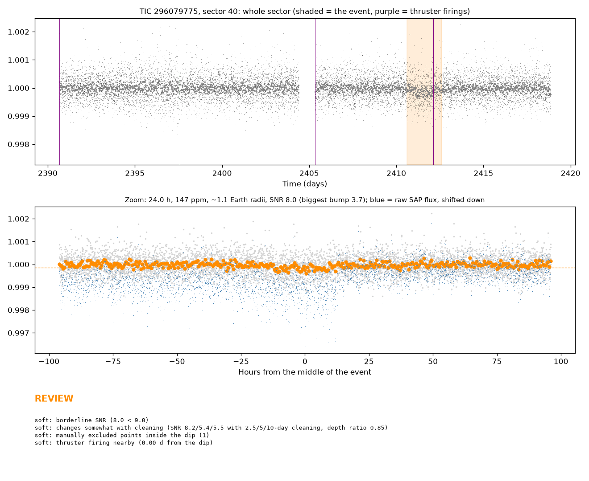
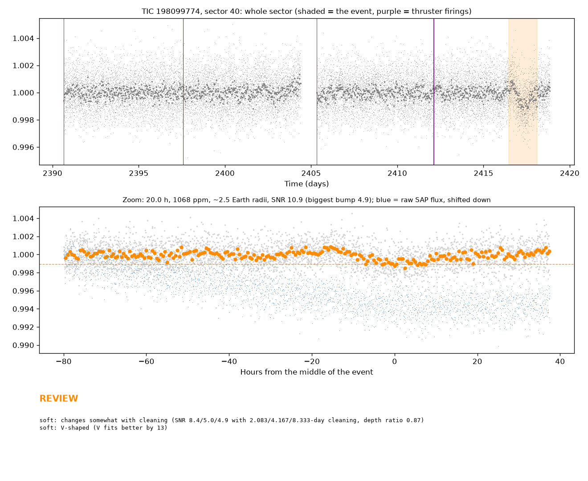
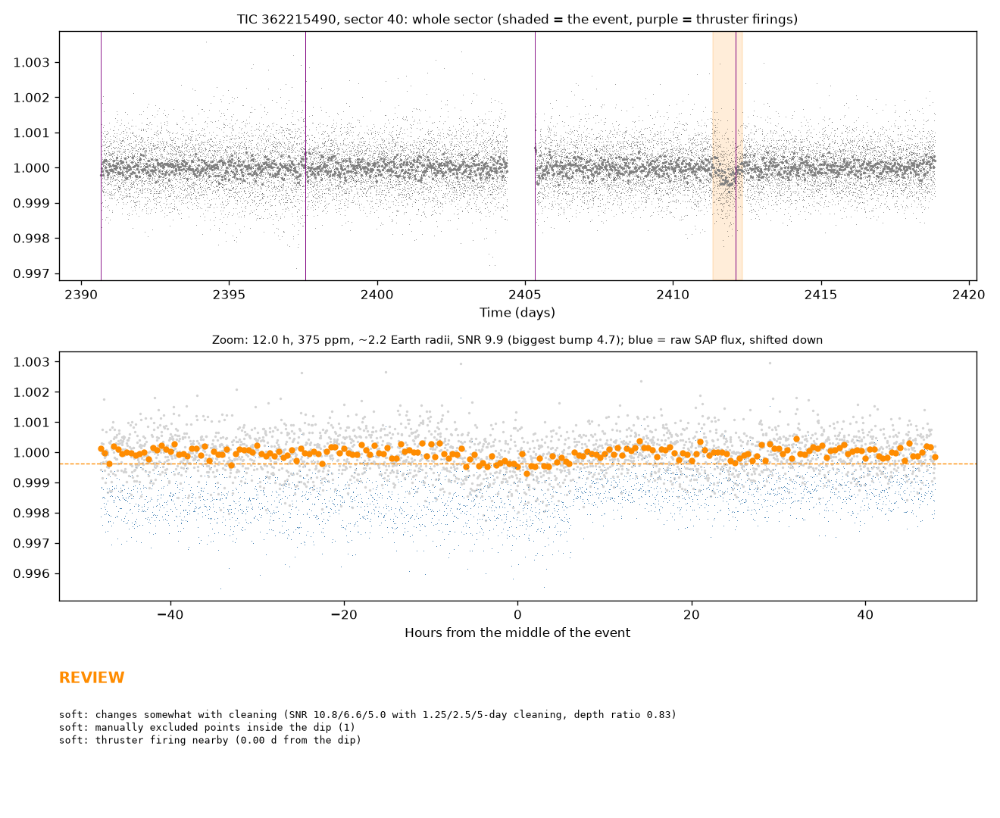
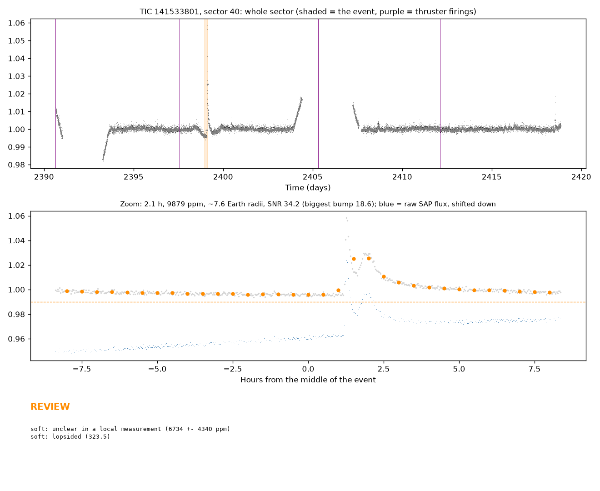
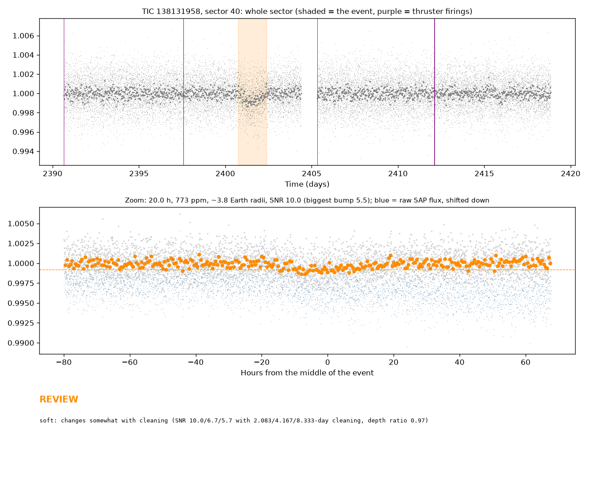

# Single-transit search: sector 40, 15 Nov 2026 13:16

200 stars in 18.8 minutes. Removed before downloading: 988 known planets/candidates, 445 TESS EB catalogue stars, 4 Gaia/VSX binaries.

| Level | Stars |
|---|---|
| CANDIDATE | 0 |
| REVIEW | 5 |
| REJECT | 62 |
| NOTHING | 133 |
| SKIPPED | 0 |
| ERROR | 0 |

## Why stars were rejected (hard checks)

| Check | Stars |
|---|---|
| changes with cleaning | 41 |
| not in raw SAP flux | 15 |
| too variable to search | 12 |
| background rises during the dip | 6 |
| repeats | 2 |
| flagged points inside the dip | 1 |

## Why stars need review (soft checks)

| Check | Stars |
|---|---|
| changes somewhat with cleaning | 4 |
| manually excluded points inside the dip | 2 |
| thruster firing nearby | 2 |
| borderline SNR | 1 |
| V-shaped | 1 |
| unclear in a local measurement | 1 |
| lopsided | 1 |

## CANDIDATE (0)

## REVIEW (5)

### TIC 296079775

- day 2411.606, 24.0 h, 147 ppm, SNR 8.0, ~1.1 Earth radii, period maybe 3338+ d
- soft fails: borderline SNR (8.0 < 9.0); changes somewhat with cleaning (SNR 8.2/5.4/5.5 with 2.5/5/10-day cleaning, depth ratio 0.85); manually excluded points inside the dip (1); thruster firing nearby (0.00 d from the dip)
- catalogues: not in catalogues
- ExoFOP: https://exofop.ipac.caltech.edu/tess/target.php?id=296079775

**Follow-up**

- ExoFOP: TOIs: none; CTOIs: none
- Gaia DR3 eclipsing binaries: lookup failed (TimeoutError)
- VSX / TESS EB / Kepler EB (5"): not in catalogues
- Other TESS sectors:
    - TESS has 4 sector(s) of this star: [26, 40, 53, 80]
    - sector 26 (SPOC): this dip would show at SNR 6; no similar dip
    - sector 40 (SPOC) (the sector with the event): this dip would show at SNR 9; no similar dip
    - sector 53 (SPOC): this dip would show at SNR 6; no similar dip
    - sector 80 (TESS-SPOC): this dip would show at SNR 7; no similar dip
    - no second dip anywhere: consistent with a long-period planet (or a one-off event)

### TIC 198099774

- day 2417.286, 20.0 h, 1068 ppm, SNR 10.9, ~2.5 Earth radii, period maybe 2810+ d
- soft fails: changes somewhat with cleaning (SNR 8.4/5.0/4.9 with 2.083/4.167/8.333-day cleaning, depth ratio 0.87); V-shaped (V fits better by 13)
- catalogues: not in catalogues
- ExoFOP: https://exofop.ipac.caltech.edu/tess/target.php?id=198099774

**Follow-up**

- ExoFOP: TOIs: none; CTOIs: none
- Gaia DR3 eclipsing binaries: lookup failed (TimeoutError)
- VSX / TESS EB / Kepler EB (5"): not in catalogues
- Other TESS sectors:
    - TESS has 8 sector(s) of this star: [14, 20, 26, 40, 47, 53, 60, 74]
    - sector 14 (SPOC): this dip would show at SNR 15; no similar dip
    - sector 20 (SPOC): this dip would show at SNR 20; no similar dip
    - sector 26 (SPOC): this dip would show at SNR 16; no similar dip
    - sector 40 (SPOC) (the sector with the event): this dip would show at SNR 11; no similar dip
    - sector 47 (SPOC): this dip would show at SNR 20; no similar dip
    - sector 53 (SPOC): this dip would show at SNR 21; no similar dip
    - sector 60 (TESS-SPOC): this dip would show at SNR 7; no similar dip
    - sector 74 (TESS-SPOC): this dip would show at SNR 9; no similar dip
    - no second dip anywhere: consistent with a long-period planet (or a one-off event)
- Looks like it could be a binary, so ZTF check of the star and neighbours within 30":
    - TIC 198099774 (Tmag 10.3, 0.0" away): too bright for ZTF (saturates)

### TIC 362215490

- day 2411.854, 12.0 h, 375 ppm, SNR 9.9, ~2.2 Earth radii, period maybe 268+ d
- soft fails: changes somewhat with cleaning (SNR 10.8/6.6/5.0 with 1.25/2.5/5-day cleaning, depth ratio 0.83); manually excluded points inside the dip (1); thruster firing nearby (0.00 d from the dip)
- catalogues: not in catalogues
- ExoFOP: https://exofop.ipac.caltech.edu/tess/target.php?id=362215490

**Follow-up**

- ExoFOP: TOIs: none; CTOIs: none
- Gaia DR3 eclipsing binaries: lookup failed (TimeoutError)
- VSX / TESS EB / Kepler EB (5"): not in catalogues
- Other TESS sectors:
    - TESS has 14 sector(s) of this star: [14, 25, 26, 40, 41, 52, 53, 54, 74, 75, 79, 80, 81, 82]
    - sector 14 (SPOC): this dip would show at SNR 12; no similar dip
    - sector 25 (SPOC): this dip would show at SNR 9; no similar dip
    - sector 26 (SPOC): this dip would show at SNR 12; no similar dip
    - sector 40 (SPOC) (the sector with the event): this dip would show at SNR 11; no similar dip
    - sector 41 (SPOC): this dip would show at SNR 14; no similar dip
    - sector 52 (SPOC): this dip would show at SNR 9; 1 similar dip(s): day 2724.27 (268 ppm, 8 h, SNR 5.4)
    - sector 53 (SPOC): this dip would show at SNR 9; no similar dip
    - sector 54 (SPOC): this dip would show at SNR 9; no similar dip
    - sector 74 (SPOC): this dip would show at SNR 13; no similar dip
    - sector 75 (SPOC): this dip would show at SNR 12; no similar dip
    - sector 79 (SPOC): this dip would show at SNR 12; 1 similar dip(s): day 3458.32 (235 ppm, 8 h, SNR 5.5)
    - sector 80 (SPOC): this dip would show at SNR 9; no similar dip
    - sector 81 (SPOC): this dip would show at SNR 16; no similar dip
    - sector 82 (SPOC): this dip would show at SNR 14; no similar dip
    - if the dip on day 3458.32 is the same planet: periods that fit = 1046.47 d, 523.23 d, 261.62 d, 149.50 d
    - the dip on day 2724.27 can't be the same planet: every period predicts a transit that TESS should have seen

### TIC 141533801

- day 2399.057, 2.1 h, 9879 ppm, SNR 34.2, ~7.6 Earth radii, period maybe 3+ d
- soft fails: unclear in a local measurement (6734 +- 4340 ppm); lopsided (323.5)
- catalogues: not in catalogues
- ExoFOP: https://exofop.ipac.caltech.edu/tess/target.php?id=141533801

**Follow-up**

- ExoFOP: lookup failed (JSONDecodeError)
- Gaia DR3 eclipsing binaries: lookup failed (TimeoutError)
- VSX / TESS EB / Kepler EB (5"): not in catalogues
- Other TESS sectors:
    - TESS has 10 sector(s) of this star: [19, 20, 26, 40, 47, 59, 60, 73, 74, 79]
    - sector 19 (SPOC): this dip would show at SNR 27; 5 similar dip(s): day 1819.87 (10048 ppm, 1 h, SNR 26.6), day 1837.64 (7401 ppm, 1 h, SNR 19.6), day 1837.77 (6315 ppm, 1 h, SNR 16.7)
    - sector 20 (SPOC): this dip would show at SNR 35; no similar dip
    - sector 26 (SPOC): this dip would show at SNR 28; 3 similar dip(s): day 2013.46 (7760 ppm, 1 h, SNR 21.3), day 2026.09 (6781 ppm, 1 h, SNR 18.6), day 2013.61 (6034 ppm, 1 h, SNR 16.6)
    - sector 40 (SPOC) (the sector with the event): this dip would show at SNR 35; 3 similar dip(s): day 2399.20 (6686 ppm, 1 h, SNR 25.5), day 2398.95 (5564 ppm, 3 h, SNR 19.9), day 2399.31 (5504 ppm, 3 h, SNR 19.7)
    - sector 47 (SPOC): this dip would show at SNR 39; no similar dip
    - sector 59 (SPOC): this dip would show at SNR 22; 10 similar dip(s): day 2934.92 (19466 ppm, 1 h, SNR 55.4), day 2935.07 (16726 ppm, 1 h, SNR 47.6), day 2920.72 (13856 ppm, 1 h, SNR 39.4)
    - sector 60 (SPOC): this dip would show at SNR 30; no similar dip
    - sector 73 (SPOC): this dip would show at SNR 35; 1 similar dip(s): day 3289.58 (5833 ppm, 1 h, SNR 21.0)
    - sector 74 (SPOC): this dip would show at SNR 31; 2 similar dip(s): day 3317.59 (7647 ppm, 1 h, SNR 25.1), day 3317.71 (5571 ppm, 1 h, SNR 18.3)
    - sector 79 (SPOC): this dip would show at SNR 31; 2 similar dip(s): day 3462.59 (8480 ppm, 1 h, SNR 28.8), day 3462.71 (6645 ppm, 1 h, SNR 22.6)
    - the dip on day 2934.92 can't be the same planet: every period predicts a transit that TESS should have seen
    - the dip on day 2935.07 can't be the same planet: every period predicts a transit that TESS should have seen
    - if the dip on day 2920.72 is the same planet: periods that fit = 521.66 d, 260.83 d, 173.89 d, 86.94 d

### TIC 138131958

- day 2401.576, 20.0 h, 773 ppm, SNR 10.0, ~3.8 Earth radii, period maybe 854+ d
- soft fails: changes somewhat with cleaning (SNR 10.0/6.7/5.7 with 2.083/4.167/8.333-day cleaning, depth ratio 0.97)
- catalogues: not in catalogues
- ExoFOP: https://exofop.ipac.caltech.edu/tess/target.php?id=138131958

**Follow-up**

- ExoFOP: TOIs: none; CTOIs: none
- Gaia DR3 eclipsing binaries: lookup failed (TimeoutError)
- VSX / TESS EB / Kepler EB (5"): not in catalogues
- Other TESS sectors:
    - TESS has 9 sector(s) of this star: [19, 20, 26, 40, 53, 59, 60, 73, 79]
    - sector 19 (TESS-SPOC): this dip would show at SNR 12; no similar dip
    - sector 20 (TESS-SPOC): this dip would show at SNR 11; no similar dip
    - sector 26 (TESS-SPOC): this dip would show at SNR 12; no similar dip
    - sector 40 (SPOC) (the sector with the event): this dip would show at SNR 10; no similar dip
    - sector 53 (SPOC): this dip would show at SNR 11; no similar dip
    - sector 59 (TESS-SPOC): this dip would show at SNR 14; no similar dip
    - sector 60 (TESS-SPOC): this dip would show at SNR 13; no similar dip
    - sector 73 (TESS-SPOC): this dip would show at SNR 12; no similar dip
    - sector 79 (TESS-SPOC): this dip would show at SNR 8; 1 similar dip(s): day 3478.42 (762 ppm, 13 h, SNR 5.4)
    - if the dip on day 3478.42 is the same planet: periods that fit = 1076.85 d, 215.37 d, 153.84 d, 97.90 d

