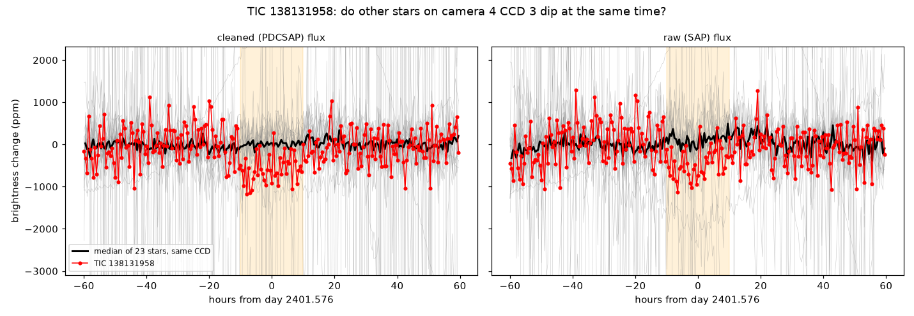
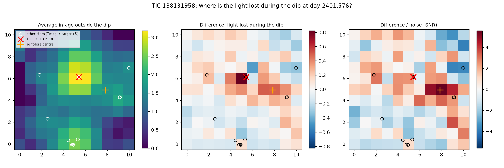
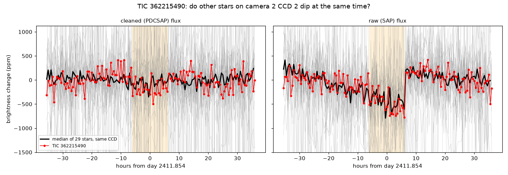
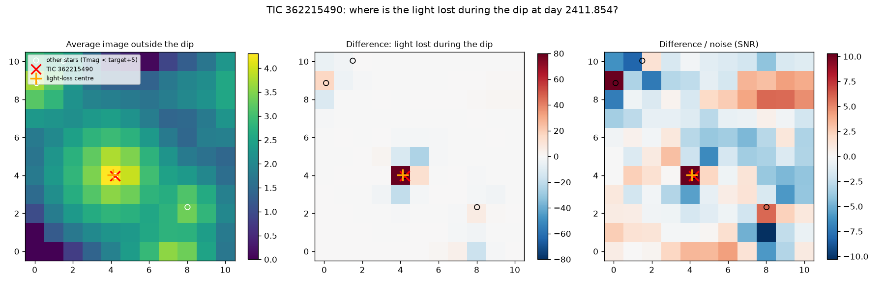
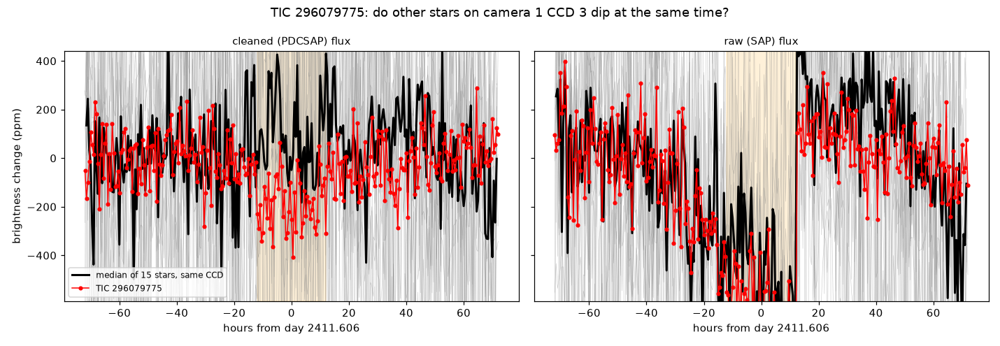
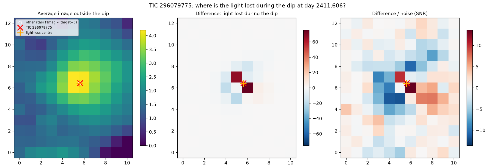
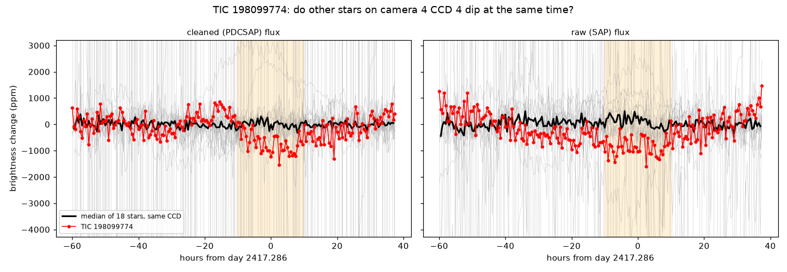
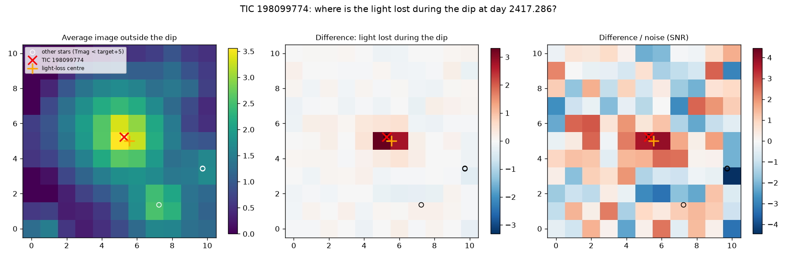

# REVIEW stars: closer look

| TIC | event | same-CCD cleaned stack | same-CCD raw stack | pixel test | suggested verdict |
|---|---|---|---|---|---|
| 138131958 | day 2401.576, 20 h, 773 ppm | +4% of dip, 0.5σ, >71% of random | -1% of dip, -0.1σ, >64% of random | strongest light-loss pixel SNR 5.6; centre 57.0" (2.71 px) from the star; SNR at the star's own pixel 2.5 | not the spacecraft; pixel test unclear (some light lost at the star, more nearby) |
| 362215490 | day 2411.854, 12 h, 375 ppm | +2% of dip, 0.1σ, >50% of random | +113% of dip, 6.3σ, >95% of random | strongest light-loss pixel SNR 10.2; centre 2.5" (0.12 px) from the star; SNR at the star's own pixel 10.2 | spacecraft (other stars dip at the same time) |
| 296079775 | day 2411.606, 24 h, 147 ppm | -33% of dip, -1.2σ, >5% of random | +275% of dip, 2.7σ, >96% of random | strongest light-loss pixel SNR 13.6; centre 0.5" (0.02 px) from the star; SNR at the star's own pixel 13.6 | spacecraft (other stars dip at the same time) |
| 198099774 | day 2417.286, 20 h, 1068 ppm | +9% of dip, 1.0σ, >95% of random | -11% of dip, -0.5σ, >47% of random | strongest light-loss pixel SNR 3.9; centre 8.0" (0.38 px) from the star; SNR at the star's own pixel 3.6 | not explained by the spacecraft or a neighbour (star variability, or still possible) |

## TIC 138131958

Event: day 2401.576, 20.0 h, 773 ppm (camera 4, CCD 3)

**Same-time test**

- same camera/CCD (4/3), cleaned flux, 23 stars: 22% dip by > 3 sigma (random moments: median 17%); stacked median +32 ppm = 4% of the target's dip, 0.5 sigma, stronger than at 71% of 58 random moments
- same camera/CCD (4/3), raw SAP flux, 23 stars: 13% dip by > 3 sigma (random moments: median 20%); stacked median -9 ppm = -1% of the target's dip, -0.1 sigma, stronger than at 64% of 58 random moments
- all cameras, cleaned flux, 387 stars: 17% dip by > 3 sigma (random moments: median 17%); stacked median -15 ppm = -2% of the target's dip, -0.9 sigma, stronger than at 12% of 58 random moments
- all cameras, raw SAP flux, 387 stars: 21% dip by > 3 sigma (random moments: median 19%); stacked median -9 ppm = -1% of the target's dip, -0.4 sigma, stronger than at 67% of 58 random moments

**Pixel test**: strongest light-loss pixel SNR 5.6; centre 57.0" (2.71 px) from the star; SNR at the star's own pixel 2.5

**All TESS data**

- TESS has 9 sector(s) of this star: [19, 20, 26, 40, 53, 59, 60, 73, 79]
- sector 19 (TESS-SPOC): this dip would show at SNR 12; no similar dip
- sector 20 (TESS-SPOC): this dip would show at SNR 11; no similar dip
- sector 26 (TESS-SPOC): this dip would show at SNR 12; no similar dip
- sector 40 (SPOC) (the sector with the event): this dip would show at SNR 10; no similar dip
- sector 53 (SPOC): this dip would show at SNR 11; no similar dip
- sector 59 (TESS-SPOC): this dip would show at SNR 14; no similar dip
- sector 60 (TESS-SPOC): this dip would show at SNR 13; no similar dip
- sector 73 (TESS-SPOC): this dip would show at SNR 12; no similar dip
- sector 79 (TESS-SPOC): this dip would show at SNR 8; 1 similar dip(s): day 3478.44 (711 ppm, 14 h, SNR 5.2)
- physics: star R = 1.25, M = 1.06 Suns; a 20-h transit needs P >= 421 d (longest central transit at that period: 16.7 h, x1.2 allowed)
- if the dip on day 3478.44 (14 h vs 20 h) is the same planet: periods that fit = 1076.87 d
-    (dropped as too short for a 20-h transit: 215.4, 153.8, 97.9 d)
- as a single transit, the periods still allowed (physics + all TESS coverage): 421-444 d, 445-446 d, 448-453 d, 455-511 d, 515-516 d, 521-525 d, 529-529 d, 547-548 d, 560-562 d, 572-575 d, 584-888 d, 891-891 d, 897-906 d, 910-1052 d, 1058-1058 d, 1060-1063 d, 1064-1065 d, 1071-1072 d, 1075-1077 d, 1077 d and longer

**Suggested verdict**: not the spacecraft; pixel test unclear (some light lost at the star, more nearby) (lost light centred 2.7 px away, star's own pixel SNR 2.5)

## TIC 362215490

Event: day 2411.854, 12.0 h, 375 ppm (camera 2, CCD 2)

**Same-time test**

- same camera/CCD (2/2), cleaned flux, 29 stars: 21% dip by > 3 sigma (random moments: median 14%); stacked median +7 ppm = 2% of the target's dip, 0.1 sigma, stronger than at 50% of 58 random moments
- same camera/CCD (2/2), raw SAP flux, 29 stars: 66% dip by > 3 sigma (random moments: median 14%); stacked median +422 ppm = 113% of the target's dip, 6.3 sigma, stronger than at 95% of 58 random moments
- all cameras, cleaned flux, 384 stars: 17% dip by > 3 sigma (random moments: median 14%); stacked median +8 ppm = 2% of the target's dip, 0.5 sigma, stronger than at 71% of 58 random moments
- all cameras, raw SAP flux, 384 stars: 65% dip by > 3 sigma (random moments: median 15%); stacked median +427 ppm = 114% of the target's dip, 18.8 sigma, stronger than at 93% of 58 random moments

**Pixel test**: strongest light-loss pixel SNR 10.2; centre 2.5" (0.12 px) from the star; SNR at the star's own pixel 10.2

**Suggested verdict**: spacecraft (other stars dip at the same time) (same camera/CCD, raw SAP flux: 66% of 29 stars dip (random moments 14%), median glitch 113% of the dip; all cameras, raw SAP flux: 65% of 384 stars dip (random moments 15%), median glitch 114% of the dip)

## TIC 296079775

Event: day 2411.606, 24.0 h, 147 ppm (camera 1, CCD 3)

**Same-time test**

- same camera/CCD (1/3), cleaned flux, 15 stars: 13% dip by > 3 sigma (random moments: median 23%); stacked median -48 ppm = -33% of the target's dip, -1.2 sigma, stronger than at 5% of 56 random moments
- same camera/CCD (1/3), raw SAP flux, 15 stars: 73% dip by > 3 sigma (random moments: median 33%); stacked median +404 ppm = 275% of the target's dip, 2.7 sigma, stronger than at 96% of 56 random moments
- all cameras, cleaned flux, 383 stars: 18% dip by > 3 sigma (random moments: median 18%); stacked median -9 ppm = -6% of the target's dip, -0.6 sigma, stronger than at 11% of 56 random moments
- all cameras, raw SAP flux, 383 stars: 76% dip by > 3 sigma (random moments: median 23%); stacked median +520 ppm = 354% of the target's dip, 18.5 sigma, stronger than at 96% of 56 random moments

**Pixel test**: strongest light-loss pixel SNR 13.6; centre 0.5" (0.02 px) from the star; SNR at the star's own pixel 13.6

**Suggested verdict**: spacecraft (other stars dip at the same time) (same camera/CCD, raw SAP flux: 73% of 15 stars dip (random moments 33%), median glitch 275% of the dip; all cameras, raw SAP flux: 76% of 383 stars dip (random moments 23%), median glitch 354% of the dip)

## TIC 198099774

Event: day 2417.286, 20.0 h, 1068 ppm (camera 4, CCD 4)

**Same-time test**

- same camera/CCD (4/4), cleaned flux, 18 stars: 22% dip by > 3 sigma (random moments: median 17%); stacked median +94 ppm = 9% of the target's dip, 1.0 sigma, stronger than at 95% of 59 random moments
- same camera/CCD (4/4), raw SAP flux, 18 stars: 39% dip by > 3 sigma (random moments: median 19%); stacked median -116 ppm = -11% of the target's dip, -0.5 sigma, stronger than at 47% of 59 random moments
- all cameras, cleaned flux, 387 stars: 22% dip by > 3 sigma (random moments: median 17%); stacked median +17 ppm = 2% of the target's dip, 1.0 sigma, stronger than at 95% of 59 random moments
- all cameras, raw SAP flux, 387 stars: 35% dip by > 3 sigma (random moments: median 19%); stacked median +41 ppm = 4% of the target's dip, 1.3 sigma, stronger than at 63% of 59 random moments

**Pixel test**: strongest light-loss pixel SNR 3.9; centre 8.0" (0.38 px) from the star; SNR at the star's own pixel 3.6

**Suggested verdict**: not explained by the spacecraft or a neighbour (star variability, or still possible)
